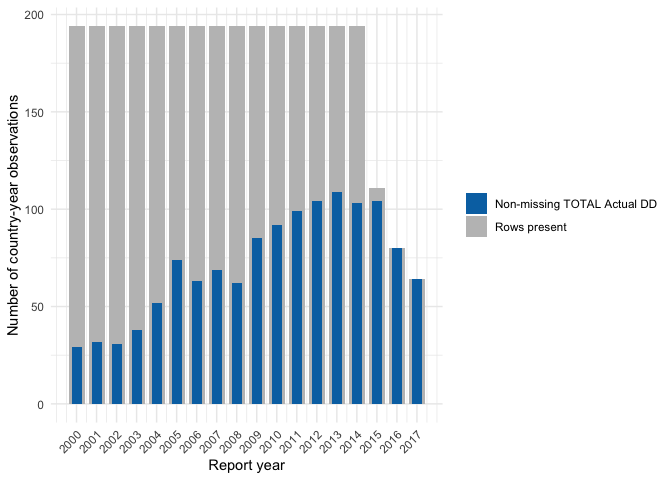

# Homework 5 — Q3: Organ Donation Data Completeness
Jiayue Zou

## Question

Work through the organ donation cleaning code and complete the
**Examining Data Completeness** section. The goal is to understand why
the data are no longer complete after 2014. For this exercise, the donor
count variable of interest is `TOTAL Actual DD`.

## Setup and data loading

``` r
library(tidyverse)
```

The source data come from the Global Observatory on Donation and
Transplantation file supplied with the *Veridical Data Science*
supplementary repository.

``` r
organs_original <- read_csv(
    "global-organ-donation_2018.csv",
  col_types = list(
    `Utilized DBD` = col_number(),
    `DD Lung Tx` = col_number(),
    `Total Utilized DD` = col_number(),
    `LD Lung Tx` = col_number()
  ),
  show_col_types = FALSE
)

dim(organs_original)
```

    [1] 3165   24

The observational unit should be a country-year. I first check the
number of distinct countries, the range of years, and whether
country-year identifiers are unique.

``` r
identifier_check <- tibble(
  countries = n_distinct(organs_original$COUNTRY),
  first_year = min(organs_original$REPORTYEAR),
  last_year = max(organs_original$REPORTYEAR),
  rows = nrow(organs_original),
  duplicate_country_years = organs_original |>
    count(COUNTRY, REPORTYEAR) |>
    filter(n > 1) |>
    nrow()
)

knitr::kable(identifier_check)
```

| countries | first_year | last_year | rows | duplicate_country_years |
|----------:|-----------:|----------:|-----:|------------------------:|
|       194 |       2000 |      2017 | 3165 |                       0 |

There are 194 countries and 18 years (2000–2017). A complete rectangular
dataset would therefore contain `194 * 18 = 3,492` country-year rows,
but the original data contain only 3,165 rows. There are no duplicated
country-year identifiers, so the difference must be caused by missing
country-year rows.

## Examining data completeness

I compare the total number of rows each year with both the missing and
non-missing counts of `TOTAL Actual DD`.

``` r
year_completeness <- organs_original |>
  group_by(REPORTYEAR) |>
  summarise(
    rows = n(),
    countries = n_distinct(COUNTRY),
    missing_total_actual_dd = sum(is.na(`TOTAL Actual DD`)),
    non_missing_total_actual_dd = sum(!is.na(`TOTAL Actual DD`)),
    .groups = "drop"
  ) |>
  mutate(
    expected_rows = n_distinct(organs_original$COUNTRY),
    absent_country_year_rows = expected_rows - rows
  )

knitr::kable(year_completeness)
```

| REPORTYEAR | rows | countries | missing_total_actual_dd | non_missing_total_actual_dd | expected_rows | absent_country_year_rows |
|---:|---:|---:|---:|---:|---:|---:|
| 2000 | 194 | 194 | 165 | 29 | 194 | 0 |
| 2001 | 194 | 194 | 162 | 32 | 194 | 0 |
| 2002 | 194 | 194 | 163 | 31 | 194 | 0 |
| 2003 | 194 | 194 | 156 | 38 | 194 | 0 |
| 2004 | 194 | 194 | 142 | 52 | 194 | 0 |
| 2005 | 194 | 194 | 120 | 74 | 194 | 0 |
| 2006 | 194 | 194 | 131 | 63 | 194 | 0 |
| 2007 | 194 | 194 | 125 | 69 | 194 | 0 |
| 2008 | 194 | 194 | 132 | 62 | 194 | 0 |
| 2009 | 194 | 194 | 109 | 85 | 194 | 0 |
| 2010 | 194 | 194 | 102 | 92 | 194 | 0 |
| 2011 | 194 | 194 | 95 | 99 | 194 | 0 |
| 2012 | 194 | 194 | 90 | 104 | 194 | 0 |
| 2013 | 194 | 194 | 85 | 109 | 194 | 0 |
| 2014 | 194 | 194 | 91 | 103 | 194 | 0 |
| 2015 | 111 | 111 | 7 | 104 | 194 | 83 |
| 2016 | 80 | 80 | 0 | 80 | 194 | 114 |
| 2017 | 64 | 64 | 0 | 64 | 194 | 130 |

The following figure overlays the number of non-missing donor counts on
the total number of rows in each year.

``` r
ggplot(year_completeness, aes(x = REPORTYEAR)) +
  geom_col(aes(y = rows, fill = "Rows present"), width = 0.8) +
  geom_col(
    aes(y = non_missing_total_actual_dd, fill = "Non-missing TOTAL Actual DD"),
    width = 0.5
  ) +
  scale_fill_manual(
    values = c(
      "Rows present" = "grey75",
      "Non-missing TOTAL Actual DD" = "#0072B2"
    )
  ) +
  scale_x_continuous(breaks = 2000:2017) +
  labs(x = "Report year", y = "Number of country-year observations", fill = NULL) +
  theme_minimal() +
  theme(axis.text.x = element_text(angle = 45, hjust = 1))
```



The change after 2014 is especially clear in the last four years.

``` r
year_completeness |>
  filter(REPORTYEAR >= 2014) |>
  knitr::kable()
```

| REPORTYEAR | rows | countries | missing_total_actual_dd | non_missing_total_actual_dd | expected_rows | absent_country_year_rows |
|---:|---:|---:|---:|---:|---:|---:|
| 2014 | 194 | 194 | 91 | 103 | 194 | 0 |
| 2015 | 111 | 111 | 7 | 104 | 194 | 83 |
| 2016 | 80 | 80 | 0 | 80 | 194 | 114 |
| 2017 | 64 | 64 | 0 | 64 | 194 | 130 |

From 2000 through 2014, every year has 194 rows—one for every
country—even when the donor count is `NA`. Beginning in 2015, missing
countries are no longer represented by rows:

- 2015 has 111 rows, so 83 country-year rows are absent. Of the 111 rows
  that remain, 104 donor counts are non-missing and only 7 are `NA`.
- 2016 has 80 rows, so 114 country-year rows are absent. All 80
  remaining donor counts are non-missing.
- 2017 has 64 rows, so 130 country-year rows are absent. All 64
  remaining donor counts are non-missing.

This means that simply counting `NA` values after 2014 is misleading:
most missing information is encoded as **absent rows**, not as explicit
`NA` values.

## Completing the country-year grid

The appropriate cleaning action is to create all 194 × 18 country-year
combinations before any imputation. Newly created rows should initially
contain `NA`, because the true donor count is unknown.

``` r
organs_complete <- organs_original |>
  complete(
    COUNTRY,
    REPORTYEAR = full_seq(REPORTYEAR, period = 1)
  )

completion_check <- organs_complete |>
  group_by(REPORTYEAR) |>
  summarise(
    rows = n(),
    missing_total_actual_dd = sum(is.na(`TOTAL Actual DD`)),
    non_missing_total_actual_dd = sum(!is.na(`TOTAL Actual DD`)),
    .groups = "drop"
  )

completion_check |>
  filter(REPORTYEAR >= 2014) |>
  knitr::kable()
```

| REPORTYEAR | rows | missing_total_actual_dd | non_missing_total_actual_dd |
|-----------:|-----:|------------------------:|----------------------------:|
|       2014 |  194 |                      91 |                         103 |
|       2015 |  194 |                      90 |                         104 |
|       2016 |  194 |                     114 |                          80 |
|       2017 |  194 |                     130 |                          64 |

``` r
stopifnot(
  nrow(organs_complete) == 194 * 18,
  all(completion_check$rows == 194)
)
```

## Summary of findings

The organ donation data become incomplete after 2014 because the storage
convention changes. Up to 2014, all 194 countries have a row each year
and unreported donor counts appear as `NA`. From 2015 onward, many
non-reporting countries disappear from the file entirely. The row count
falls from 194 in 2014 to 111 in 2015, 80 in 2016, and 64 in 2017. At
the same time, explicit missing values fall to 7, 0, and 0. Therefore,
the apparent decline in missing values does not indicate better
reporting; it reflects the omission of entire country-year rows. The
data should be completed to the full country-year grid before
donor-count imputation or calculation of worldwide totals.
